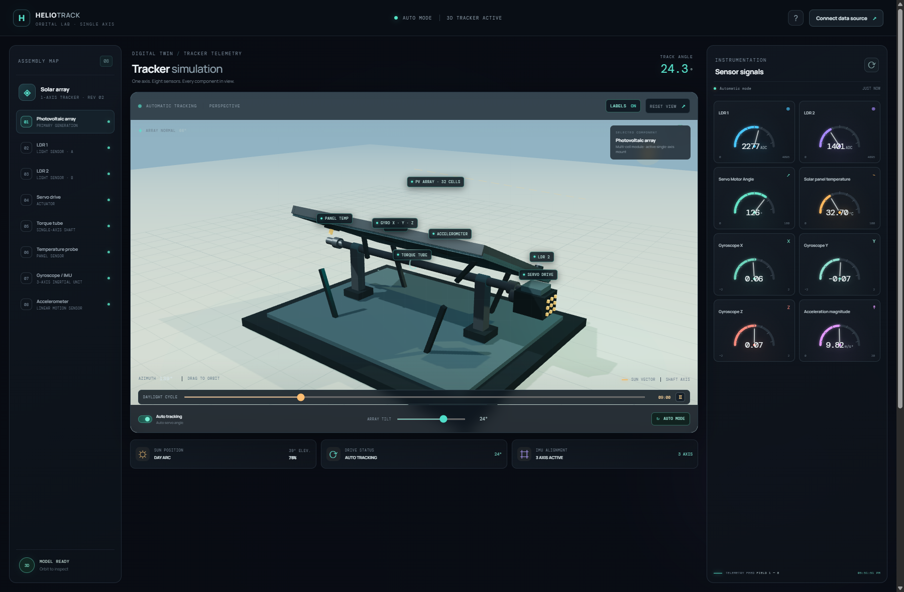
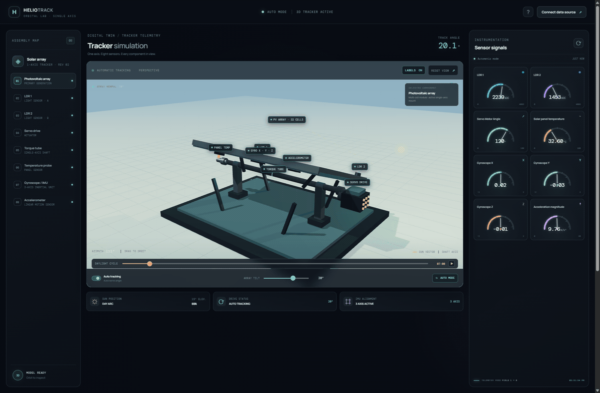

# HelioTrack · 3D Solar Tracker Lab

An interactive 3D tracker with an animated daylight cycle, component labels, sensor gauges, and telemetry history.



## 3D tracker

The panel follows the sun as its position changes. Orbit the camera, adjust panel tilt, and view the named assembly parts.



## Features

- 3D single-axis tracker with a moving sun and adjustable daylight cycle.
- Eight sensor gauges for both LDRs, servo angle, temperature, three gyroscope axes, and acceleration.
- Telemetry trend, LDR comparison, and gyroscope charts with local history.
- USB serial, ThingSpeak, ESP32 Wi-Fi JSON, and Bluetooth LE connections.
- Automatic tracker feed that refreshes gauges and history every three seconds while no source is connected.

## Run on Windows

Double-click `run.bat` in this folder. It serves the project on port 4174. Keep the terminal window open and visit [http://localhost:4174](http://localhost:4174).

Or run this command from the folder that contains `index.html`:

```bash
python -m http.server 4174
```

The 3D scene and fonts load from CDNs, so the browser needs internet access.

## Connect the ESP32 over USB

1. Use Chrome or Edge and open the dashboard on localhost.
2. Close Arduino Serial Monitor so it releases the COM port.
3. Choose **Connect data source → ESP32 USB serial · COM port**.
4. Keep **115200 baud**, click **Save & Connect**, and choose the ESP32 port (COM7) in the browser prompt.

The dashboard reads the sketch's labeled serial output and updates the gauges and charts as each sensor block arrives. After the one-time browser permission, it reconnects to the selected device when the USB cable is reconnected. If there is no USB connection, **AUTO MODE** keeps the dashboard moving at three-second intervals.

USB serial access requires the browser's permission. The first connection must be selected from the browser's port chooser; afterward the browser can reopen that permitted port.

## Other connections

Open **Connect data source** to configure ThingSpeak, an ESP32 JSON endpoint, or Bluetooth LE. ThingSpeak read keys are stored in this browser's local storage. Use read-only keys; never enter a write key. Wi-Fi endpoints must allow CORS.

## Controls

- Drag to orbit the 3D model; select an assembly part to focus it.
- Use **Daylight cycle** to move or pause the sun.
- Adjust **Array tilt** or enable **Auto tracking**.
- Select a sensor and time range in **Telemetry analytics**.

## Project files

```text
run.bat      Windows launcher on port 4174
index.html   Dashboard and connection controls
styles.css   Responsive interface
app.js       3D scene, serial input, source connections, gauges, and charts
docs/screenshots/
  heliotrack-dashboard.png
  heliotrack-sun-tracking.gif
```

## Technology

HTML, CSS, JavaScript modules, Three.js, Web Serial, ThingSpeak REST, Web Bluetooth, and Canvas charts.

## License

No license file is included yet. Contact the repository owner before redistributing or reusing this project.
